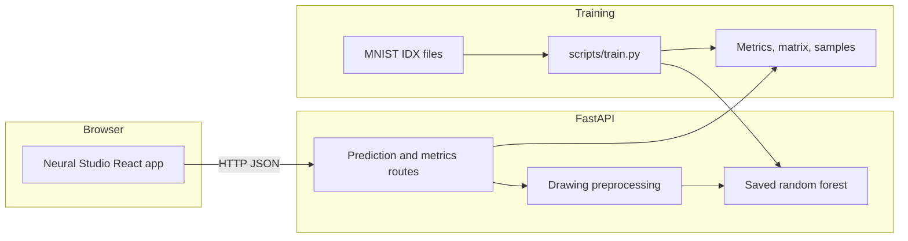
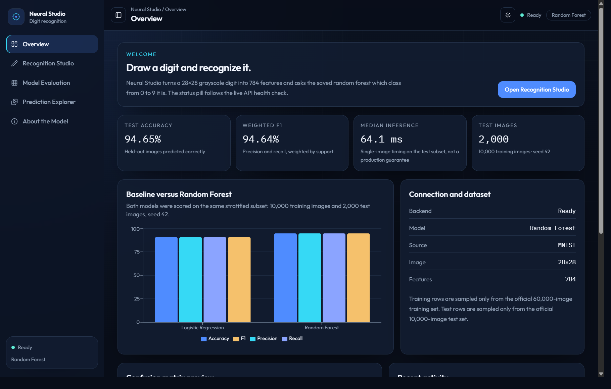
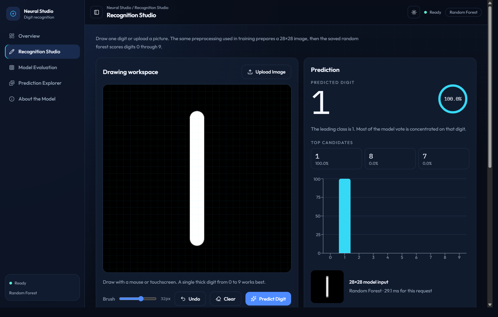
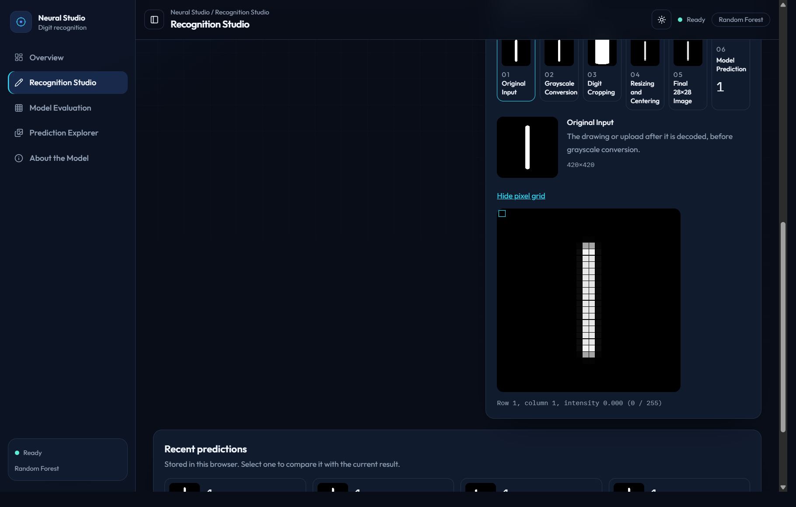
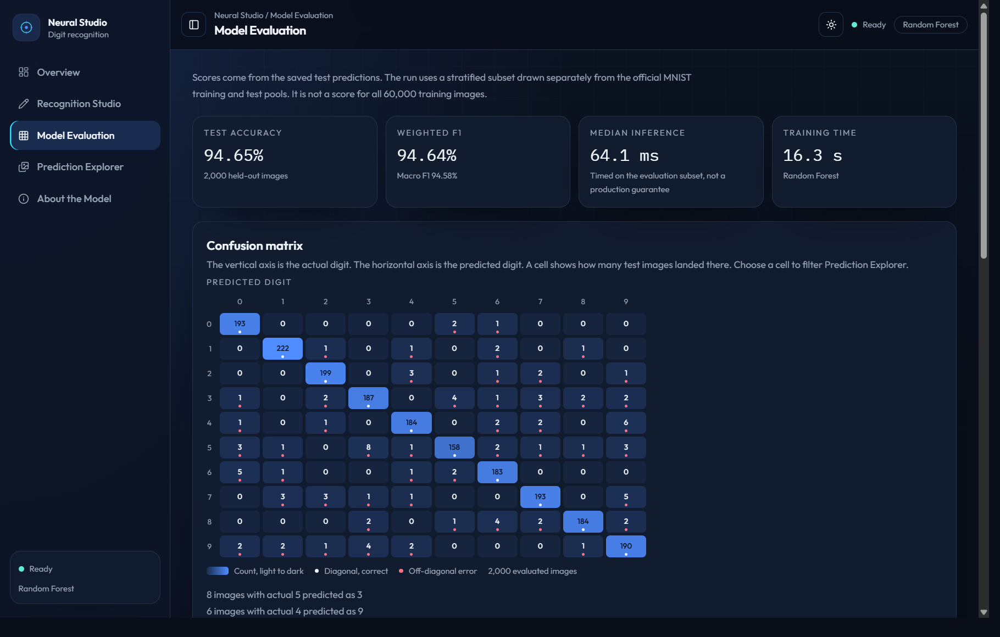
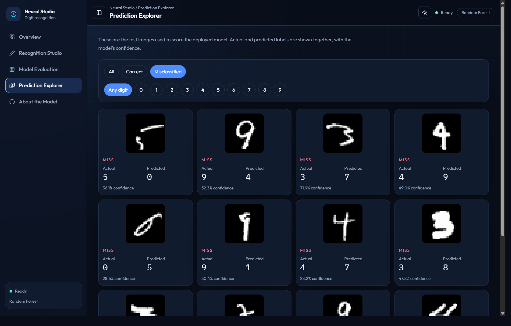
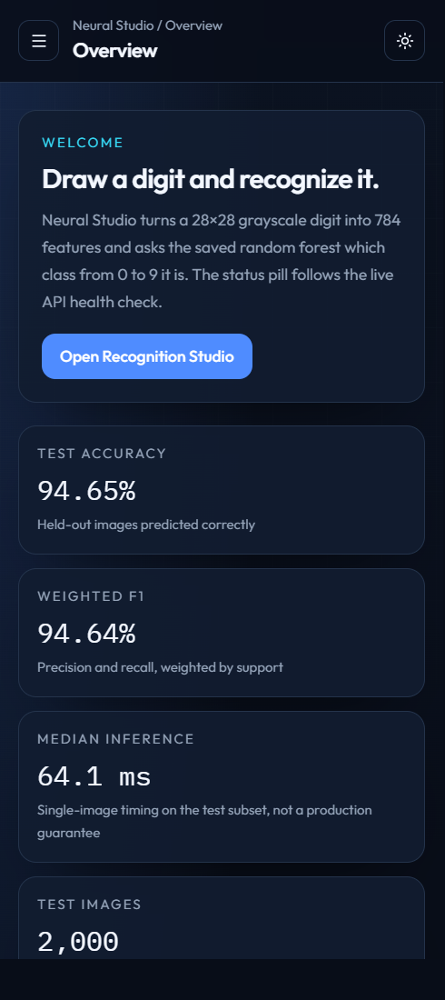
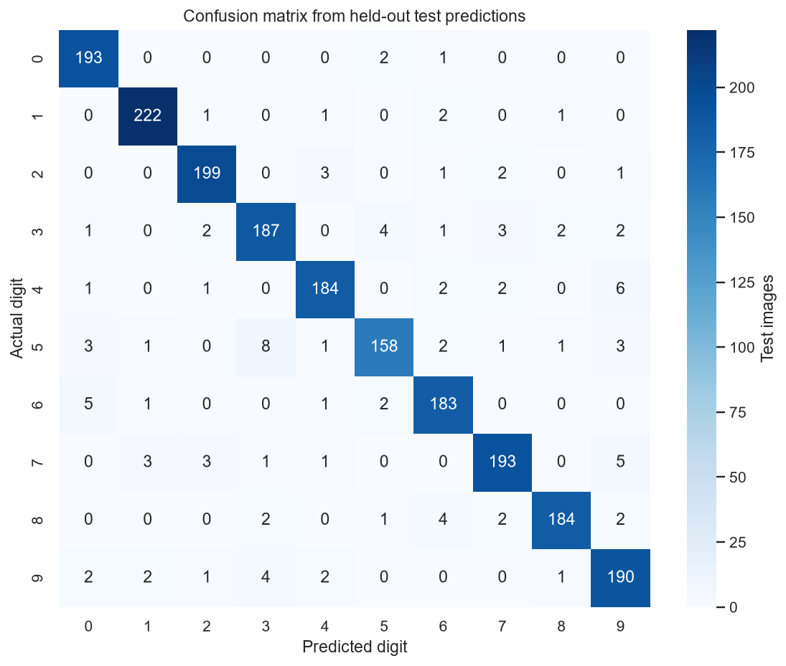
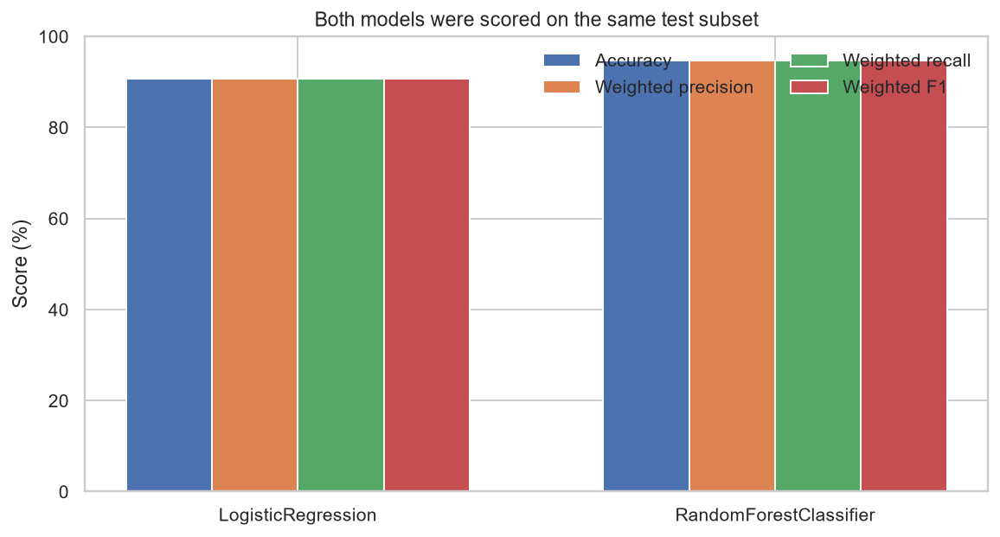
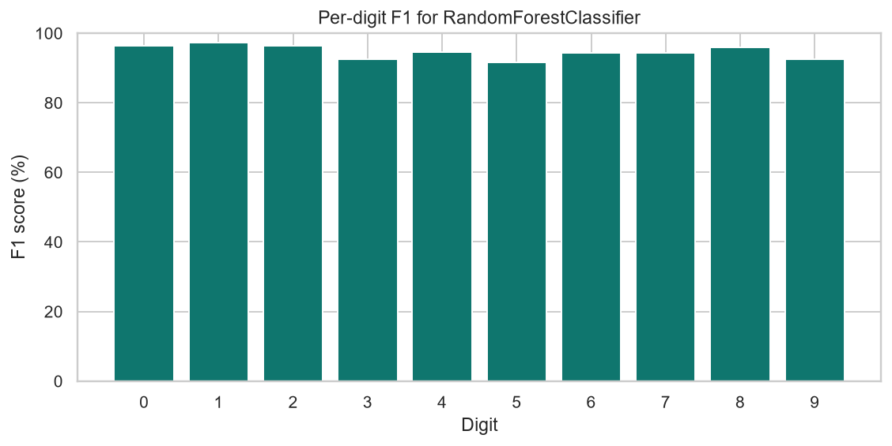

# Neural Studio

Neural Studio is a local handwritten-digit recognizer. A scikit-learn random forest reads one digit from 0 to 9. A React application provides the drawing canvas, evaluation dashboard, and test-image explorer. FastAPI serves the saved model.

Each image is 28×28 grayscale and becomes 784 features scaled from 0–255 to 0–1. The published scores come from a stratified subset of MNIST, not from a model trained on all 60,000 training images.


These badges name the versions used for the recorded run. This repository does not have a continuous-integration workflow, so they are not a live build status.

## Features

- Drawing canvas with brush size, undo, clear, and image upload
- Prediction with confidence, the top candidates, and a ten-class probability chart
- Real preprocessing previews, from the original image through the final 28×28 model input
- Optional inspector for all 784 pixel intensities
- Evaluation dashboard with a clickable confusion matrix, per-digit metrics, and a logistic-regression baseline
- Prediction Explorer for the saved test images, with filters and pagination
- API health indicator that reports offline and recovers when the backend returns

## Architecture



## Screenshots

These images were captured from the running Neural Studio app. The API was `http://127.0.0.1:8010` and the UI was `http://127.0.0.1:5174`. The recognition shot is a stroke drawn on the canvas. The model returned digit 1 at 100.0% confidence. The explorer shows real misclassified images from the saved test subset.













The training script also wrote these plots from the same test predictions:







## Tech stack

- Python 3.11, NumPy, pandas, SciPy, Pillow, and joblib
- scikit-learn `RandomForestClassifier` and `LogisticRegression`
- FastAPI and Uvicorn
- React 19, TypeScript, Vite, Tailwind CSS, Recharts, and Lucide
- pytest, Vitest, and Testing Library

## Dataset and evaluation

[MNIST](http://yann.lecun.com/exdb/mnist/) was released by Yann LeCun, Corinna Cortes, and Christopher J.C. Burges. It contains 60,000 training images and 10,000 test images of digits 0–9. This repository does not add a separate dataset license. `scripts/download_data.py` downloads the public IDX archives and checks their headers. The original training and test pools are not mixed.

The recorded experiment uses a stratified sample: **10,000** training images and **2,000** test images, random seed **42**. Stratification keeps every digit in both sets. The test images are used only for scoring.

| Model | Role | Accuracy | Weighted F1 | Macro F1 | Training time | Median single-image inference |
| --- | --- | ---: | ---: | ---: | ---: | ---: |
| Logistic regression | Baseline | 90.75% | 90.72% | 90.59% | 69.25 s | 0.84 ms |
| Random forest | Deployed | 94.65% | 94.64% | 94.58% | 16.27 s | 64.06 ms |

- Weighted precision / recall for the random forest: 94.67% / 94.65%
- Correct predictions: 1,893 of 2,000. Incorrect: 107
- Lowest per-digit F1: digit 5 at 91.59% (recall 88.76%)
- Largest confusions: 5 predicted as 3 (8), 4 as 9 (6), 7 as 9 (5), 6 as 0 (5)
- Random forest settings: 80 trees, max depth 22, 48 features per split, minimum 2 samples per leaf
- These figures are subset scores. They are not a full-MNIST benchmark.

The 64.1 ms figure is the median time to score one saved test vector during evaluation. It is not a guaranteed API or production latency. A live drawing request also spends time on image decoding and preprocessing.

Reported confidence is the share of trees that voted for a digit. It is a model output, not a calibrated probability.

## Prediction workflow

1. The browser sends a canvas PNG or an uploaded PNG, JPEG, WebP, or BMP.
2. The API decodes the file, converts it to grayscale, and inverts it when the border is light.
3. Ink is cropped, padded, and stretched if the stroke is faint.
4. The crop keeps its aspect ratio, fits inside a 20×20 box, and is placed on a blank 28×28 canvas.
5. A light blur and a center-of-mass shift produce 784 values in the range 0 to 1.
6. The saved random forest returns a digit, a score for every class, and the real intermediate images.

A blank canvas or an image with too little ink returns HTTP 400 and code `blank_canvas`. Uploads are limited to 2 MB and to images from 8×8 through 2048×2048.

## Repository structure

```text
backend/app/api          HTTP routes
backend/app/ml           MNIST loading, preprocessing, training, scoring
backend/app/services     Model loading and evaluation artifacts
backend/models           Saved random forest and metadata
backend/artifacts        Metrics, confusion matrix, and test samples
backend/tests            pytest suite
frontend/src             Neural Studio React application
reports                  Evaluation figures from the recorded run
scripts                  Download, train, and evaluate
docs                     Status note and the finalization prompt
```

## Prerequisites

- CPython 3.11. On Windows, the `py -3.11` launcher is the one used for this project. Do not use a mismatched interpreter for scikit-learn.
- Node.js 22, with npm, for the frontend.
- Git.

The saved model in `backend/models/digit_model.joblib` and the JSON files in `backend/artifacts/` are included, so prediction and the dashboards work without retraining. MNIST archives are not included. Training downloads them into `data/mnist/`, which is gitignored.

## Installation

From the repository root.

Windows:

```powershell
py -3.11 -m venv .venv
.\.venv\Scripts\python.exe -m pip install -r backend\requirements.txt
cd frontend
npm install
```

macOS and Linux:

```bash
python3.11 -m venv .venv
.venv/bin/python -m pip install -r backend/requirements.txt
cd frontend
npm install
```

Retrain only when you want a new experiment. If download or training fails, the script stops and does not replace the saved metrics.

Windows:

```powershell
.\.venv\Scripts\python.exe scripts\download_data.py
.\.venv\Scripts\python.exe scripts\train.py
.\.venv\Scripts\python.exe scripts\evaluate.py
```

macOS and Linux:

```bash
.venv/bin/python scripts/download_data.py
.venv/bin/python scripts/train.py
.venv/bin/python scripts/evaluate.py
```

`scripts/evaluate.py` reloads the saved model, predicts the same test sample, and exits with an error if the confusion matrix does not match the artifact.

## Run the application

The API default is port **8000**. The UI default is port **5173**. `frontend/vite.config.ts` binds the dev server to `127.0.0.1`, reads `DEV_PORT` (default 5173), and uses `strictPort`, so Vite exits if that port is taken. Leave an unrelated program running and choose another port.

Windows, default ports:

```powershell
.\.venv\Scripts\python.exe -m uvicorn app.main:app --app-dir backend --host 127.0.0.1 --port 8000
```

```powershell
cd frontend
npm run dev
```

Open [http://127.0.0.1:5173](http://127.0.0.1:5173). API docs are at [http://127.0.0.1:8000/docs](http://127.0.0.1:8000/docs).

macOS and Linux, default ports:

```bash
.venv/bin/python -m uvicorn app.main:app --app-dir backend --host 127.0.0.1 --port 8000
```

```bash
cd frontend
npm run dev
```

The UI calls `VITE_API_URL` when it is set, and `http://localhost:8000` otherwise. See `frontend/.env.example`. Default CORS allows `localhost` and `127.0.0.1` on ports 5173, 5174, and 4173.

On the machine used for the last check, ports 8000 and 5173 were already used by other applications. The verified processes were:

```powershell
$env:CORS_ORIGINS="http://127.0.0.1:5174,http://localhost:5174"
.\.venv\Scripts\python.exe -m uvicorn app.main:app --app-dir backend --host 127.0.0.1 --port 8010
```

```powershell
cd frontend
$env:DEV_PORT="5174"
$env:VITE_API_URL="http://127.0.0.1:8010"
npm run dev
```

That serves the UI at [http://127.0.0.1:5174](http://127.0.0.1:5174) and the API at [http://127.0.0.1:8010](http://127.0.0.1:8010). A health check against that API returned `status: ok` with `RandomForestClassifier` loaded.

`docker-compose.yml` describes the same two processes on ports 8000 and 5173. Compose was not executed in the recorded verification, so this README does not claim that the containers build or start.

## Live demo

There is no public URL yet. GitHub Pages can serve the static UI, but it cannot run the FastAPI process or the saved random forest. Render, Railway, Fly, and Vercel were not signed in on this machine, and the Docker engine was not running, so a hosted deploy was not started. See `docs/PROJECT_STATUS.md` for the exact gap.

## API

| Method | Path | Purpose |
| --- | --- | --- |
| GET | `/api/health` | Process and model status |
| POST | `/api/predict` | Predict an uploaded PNG, JPEG, WebP, or BMP |
| POST | `/api/predict/drawing` | Predict a base64 canvas image |
| GET | `/api/metrics` | Accuracy, F1, per-digit scores, and model comparison |
| GET | `/api/confusion-matrix` | 10×10 matrix from the test predictions |
| GET | `/api/model-info` | Dataset, parameters, library versions, and metrics |
| GET | `/api/samples` | Paged test images with actual and predicted labels |

```powershell
curl http://127.0.0.1:8000/api/health
curl -F "file=@reports/upload_example.png" http://127.0.0.1:8000/api/predict
curl "http://127.0.0.1:8000/api/samples?outcome=incorrect&page=1&page_size=12"
```

A drawing body is `{"image_base64": "data:image/png;base64,..."}`.

A prediction includes the digit, one score per class, the ranked guesses, the preprocessing preview, inference time, and the additive fields `pipeline` and `pixels`. `pipeline` is the real preprocessing sequence. `pixels` is the 784 normalized values. Older clients can ignore both fields.

`reports/upload_example.png` is a nearest-neighbor enlargement of one real test image. Its label is 2, and the recorded upload check predicted 2 with confidence 0.354. The enlarged image is blockier than the original 28×28 vector, so the confidence is lower than a typical in-sample score.

## Tests and production build

Windows:

```powershell
.\.venv\Scripts\python.exe -m pytest
cd frontend
npm test
npm run build
```

macOS and Linux:

```bash
.venv/bin/python -m pytest
cd frontend
npm test
npm run build
```

`npm run build` runs `tsc --noEmit` and then the Vite production build.

The run on 17 October 2026 passed **29** backend tests and **18** frontend tests, and the production build completed. Pytest prints a Starlette deprecation warning about `httpx` and `TestClient`. The tests still pass. No ESLint script is configured. Docker and a hosted CI workflow were not run.

## Troubleshooting

- **Port already in use.** Do not stop the other program. Start the API with `--port 8010` and the UI with `DEV_PORT=5174` and `VITE_API_URL` pointed at that API. Set `CORS_ORIGINS` if the UI origin is not already allowed.
- **UI says the service is unavailable.** The frontend is calling the wrong host. Set `VITE_API_URL` and restart `npm run dev`, because Vite reads it at startup.
- **Health says the model needs training.** `backend/models/digit_model.joblib` or the files in `backend/artifacts/` are missing. Restore them or run `scripts/train.py`.
- **scikit-learn fails to import.** Recreate the virtual environment with CPython 3.11. A different Python build can fail to load the saved model.
- **Blank canvas error.** The drawing has too little ink. Use a thicker, centered digit.
- **Upload rejected.** Use PNG, JPEG, WebP, or BMP, at most 2 MB, between 8×8 and 2048×2048.
- **Vite exits immediately.** `strictPort` is on. Another process already has `DEV_PORT`.

## Limitations and responsible use

- Scores are for a 10,000 / 2,000 stratified subset, not a forest trained on every MNIST training image.
- The model uses raw pixels. It is not a convolutional network, and it reads one digit at a time.
- Confidence is the share of trees, not a calibrated probability. A high score can still be wrong, and a low score can still be right.
- Thin strokes, rotation, extra marks, and uneven lighting move a drawing away from the MNIST style. The UI warns when confidence is under 45%.
- Single-image API latency includes preprocessing and is separate from the 64.1 ms evaluation median.
- This is a local demonstration. It is not an identity check, a grading system, or a medical or financial decision tool.

## Conclusion

Neural Studio is a complete, inspectable digit-recognition project: a reproducible subset experiment, a saved scikit-learn model, a small API, and a browser workspace that shows both the prediction and the image the model actually receives.
